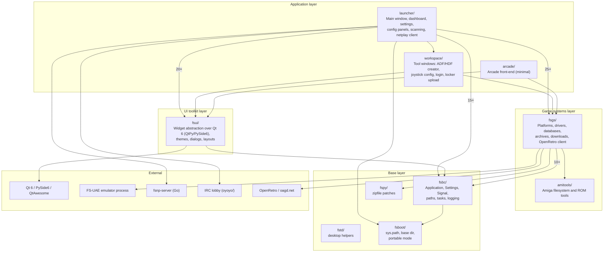
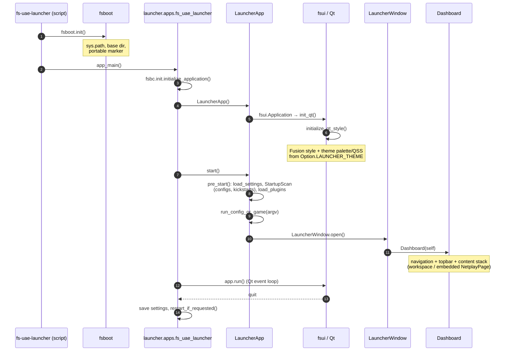
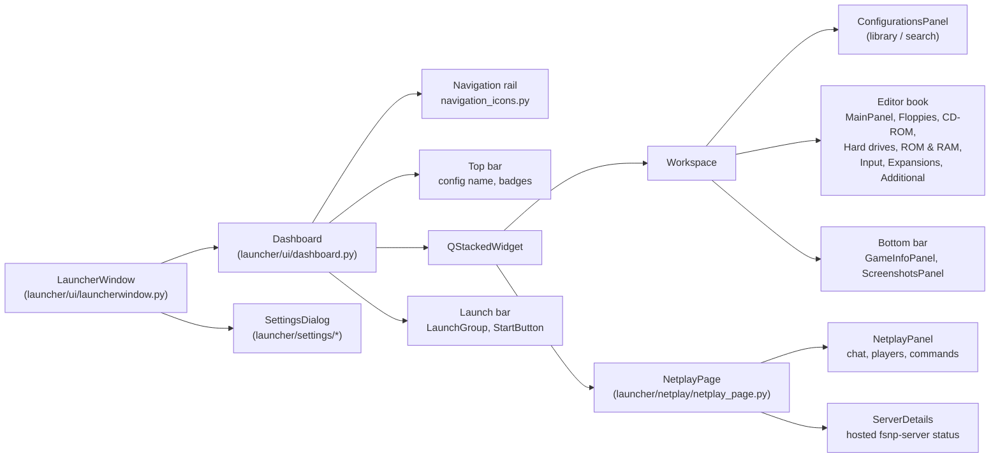
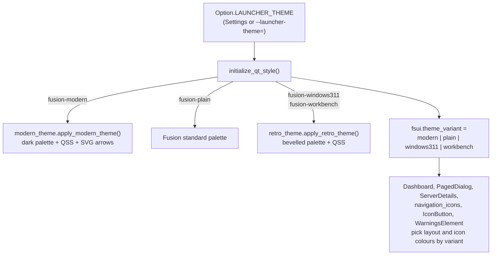
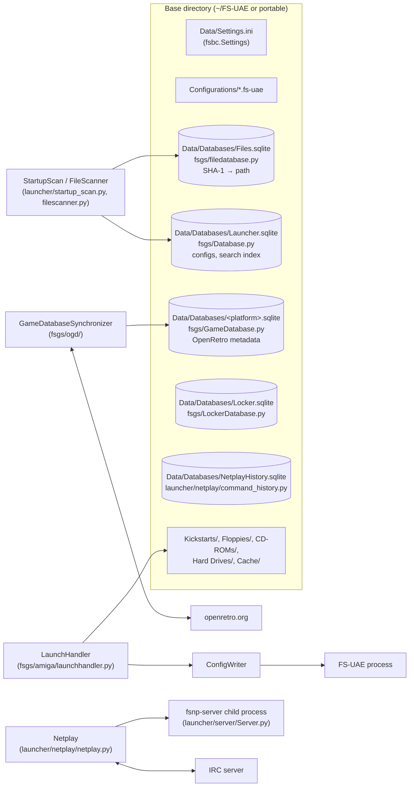

# FS-UAE Launcher Architecture

A map of the launcher's Python packages, how they depend on each other, how
the application starts, and where its data lives. Diagrams are Mermaid and
render on GitHub and in VS Code's Markdown preview.

| | |
|---|---|
| **Date** | 2026-10-31 |
| **Scope** | The Python launcher (`fs-uae-launcher`). The Go netplay server has its own notes in [fsnp-server/README.md](../fsnp-server/README.md) and [netplay-go-server-design.md](netplay-go-server-design.md). |
| **Out of scope** | `venv-*/`, `oyoyo/` internals |

## Layers

The code is layered from the bottom up. Each package imports only from the
layers below it; the counts are `from X import` / `import X` statements.

### Package responsibilities

| Package | Responsibility | Key modules |
|---|---|---|
| `fsboot/` | First thing imported. Fixes `sys.path`, finds the base directory (`~/FS-UAE` or a portable marker), exposes `fsboot.init()`. | [fsboot/__init__.py](../fsboot/__init__.py) |
| `fsbc/` | Framework base: `Application`, `Settings` (persisted key/value), `Signal`, `Task`, path and desktop helpers, logging setup. | [application.py](../fsbc/application.py), [settings.py](../fsbc/settings.py), [signal.py](../fsbc/signal.py), [init.py](../fsbc/init.py) |
| `fspy/`, `fstd/` | Small stdlib patches and desktop-environment helpers. | [fspy/zipfile.py](../fspy/zipfile.py) |
| `fsui/` | Toolkit-neutral widget API (`Panel`, `Button`, `Choice`, layouts, dialogs) implemented on Qt in `fsui/qt/`. Owns the theme engine. | [fsui/qt/qt.py](../fsui/qt/qt.py), [modern_theme.py](../fsui/qt/modern_theme.py), [retro_theme.py](../fsui/qt/retro_theme.py) |
| `fsgs/` | Everything about games and emulators that is not UI: the `fsgs` context singleton, platforms and drivers, SQLite databases, archive reading, file scanning, OpenRetro sync, plugin discovery. | [context.py](../fsgs/context.py), [Database.py](../fsgs/Database.py), [amiga/launchhandler.py](../fsgs/amiga/launchhandler.py), [drivers/gamedriver.py](../fsgs/drivers/gamedriver.py) |
| `amitools/` | Vendored Amiga tooling used for ADF/HDF and ROM inspection. | `amitools/fs`, `amitools/rom` |
| `launcher/` | The application: `LauncherApp`, `LauncherWindow`, the dashboard shell, configuration panels, the Settings dialog, startup scans, netplay client, option metadata. | [launcherapp.py](../launcher/launcherapp.py), [ui/launcherwindow.py](../launcher/ui/launcherwindow.py), [ui/dashboard.py](../launcher/ui/dashboard.py), [option.py](../launcher/option.py) |
| `workspace/` | Secondary tool windows opened from the launcher (ADF and HDF creators, joystick configuration, OpenRetro login/logout, locker upload, refresh), with their own small widget set in `workspace/ui`. | [workspace/apps](../workspace/apps) |
| `oyoyo/` | Vendored IRC client used by the netplay lobby. | |
| `fsnp-server/` | Go netplay server, run as a child process when hosting a game. | [fsnp-server/README.md](../fsnp-server/README.md) |
| `fsbuild/` | Build and packaging scripts (PyInstaller, DMG, deb). Not imported at runtime. | |

## Startup sequence

## Main window composition

## Theme engine

Theme selection is one `Settings` key, `launcher_theme`, declared in
[launcher/option.py](../launcher/option.py) and dispatched by
`initialize_qt_style()` in [fsui/qt/qt.py](../fsui/qt/qt.py). Every theme
runs on Qt's Fusion style; themes differ by palette, stylesheet and font.

The Settings page offers a *Restart Launcher* button; `LauncherApp.request_restart()`
saves settings and re-executes the process so a new theme applies cleanly.

## Data and external processes

## Tests

| Suite | Command | Platform |
|---|---|---|
| Core | `python -W default::DeprecationWarning -m pytest fsbc fstd fspy fsbuild/tests launcher/netplay launcher/tests` | any |
| Qt widgets, panels and themes | `QT_QPA_PLATFORM=offscreen python -m pytest fsui/test/test_qt6.py` | offscreen |
| Lint | `ruff check` | any |
| Go server | `make -C fsnp-server check` | Go toolchain |

CI runs these in [.github/workflows/linux.yml](../.github/workflows/linux.yml).
Qt tests that build a real `LauncherWindow` use isolated temporary base
directories and mock the IRC transport and server process.
