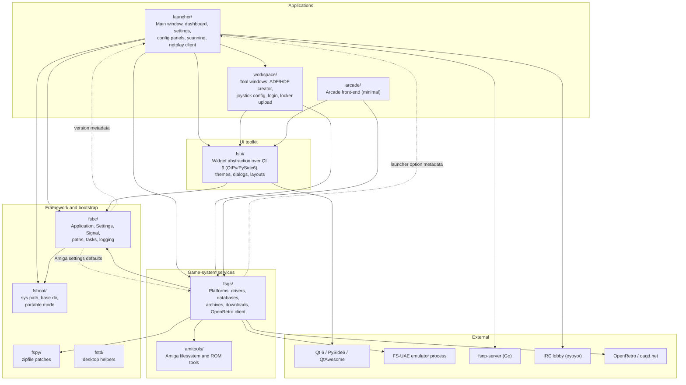
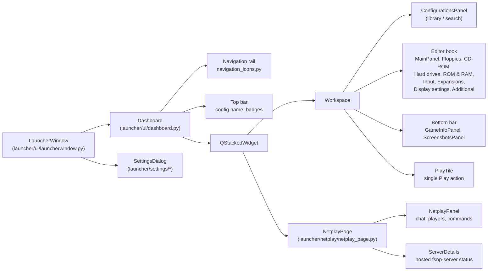
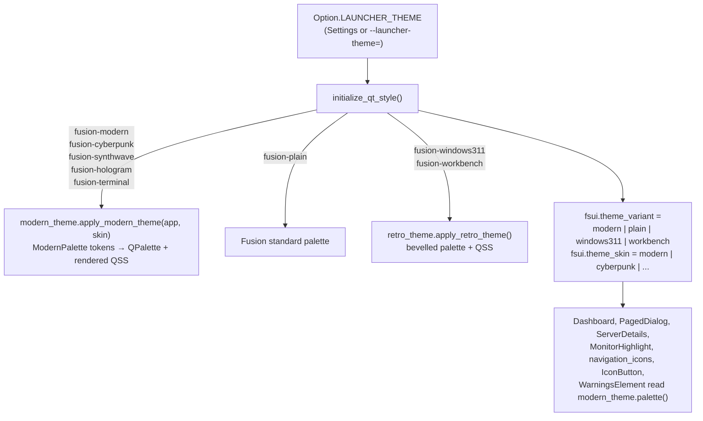
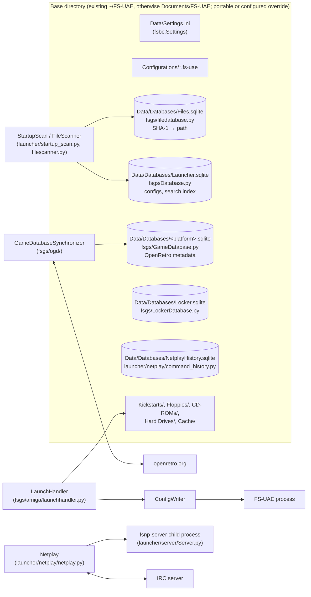

# FS-UAE Launcher Architecture

A map of the launcher's Python packages, how they depend on each other, how
the application starts, and where its data lives. Diagrams are Mermaid and
render on GitHub and in VS Code's Markdown preview.

| | |
|---|---|
| **Date** | 2026-10-31 |
| **Scope** | The Python launcher (`fs-uae-launcher`). The Go netplay server has its own notes in [fsnp-server/README.md](../fsnp-server/README.md) and [netplay-go-server-design.md](netplay-go-server-design.md). |
| **Out of scope** | `venv-*/`, `oyoyo/` internals |

## Responsibility groups

These are responsibility groups, not strict import layers. The diagram shows
selected dependencies rather than an exhaustive import graph. Cross-group
imports exist in both directions: for example, `fsbc.settings` imports
`launcher.version` and `fsgs.amiga.amiga`, while `fsgs.drivers.gamedriver`
imports `launcher.option`.



### Package responsibilities

| Package | Responsibility | Key modules |
|---|---|---|
| `fsboot/` | First thing imported. `init()` records startup arguments and sets up `sys.path`. `base_dir()` resolves the data root lazily: existing `~/FS-UAE`, otherwise `documents_dir()/FS-UAE`, with portable markers and configured overrides taking precedence. | [fsboot/__init__.py](../fsboot/__init__.py) |
| `fsbc/` | Framework base: `Application`, `Settings` (persisted key/value), `Signal`, `Task`, path and desktop helpers, logging setup. | [application.py](../fsbc/application.py), [settings.py](../fsbc/settings.py), [signal.py](../fsbc/signal.py), [init.py](../fsbc/init.py) |
| `fspy/`, `fstd/` | Small stdlib patches and desktop-environment helpers. | [fspy/zipfile.py](../fspy/zipfile.py) |
| `fsui/` | Toolkit-neutral widget API (`Panel`, `Button`, `Choice`, layouts, dialogs) implemented on Qt in `fsui/qt/`. Owns the theme engine. | [fsui/qt/qt.py](../fsui/qt/qt.py), [modern_theme.py](../fsui/qt/modern_theme.py), [retro_theme.py](../fsui/qt/retro_theme.py) |
| `fsgs/` | Game and emulator services: the `fsgs` context singleton, platforms and drivers, SQLite databases, archive reading, file scanning, OpenRetro sync, plugin discovery. Some driver code also depends on launcher options and Qt display information. | [context.py](../fsgs/context.py), [Database.py](../fsgs/Database.py), [amiga/launchhandler.py](../fsgs/amiga/launchhandler.py), [drivers/gamedriver.py](../fsgs/drivers/gamedriver.py) |
| `amitools/` | Vendored Amiga tooling used for ADF/HDF and ROM inspection. | `amitools/fs`, `amitools/rom` |
| `launcher/` | The application: `LauncherApp`, `LauncherWindow`, the dashboard shell, configuration panels, the Settings dialog, startup scans, netplay client, option metadata. | [launcherapp.py](../launcher/launcherapp.py), [ui/launcherwindow.py](../launcher/ui/launcherwindow.py), [ui/dashboard.py](../launcher/ui/dashboard.py), [option.py](../launcher/option.py) |
| `workspace/` | Secondary tool windows opened from the launcher (ADF and HDF creators, joystick configuration, OpenRetro login/logout, locker upload, refresh), with their own small widget set in `workspace/ui`. | [workspace/apps](../workspace/apps) |
| `oyoyo/` | Vendored IRC client used by the netplay lobby. | |
| `fsnp-server/` | Go netplay server, run as a child process when hosting a game. | [fsnp-server/README.md](../fsnp-server/README.md) |
| `fsbuild/` | Build and packaging scripts (PyInstaller, DMG, deb). Not imported at runtime. | |

## Startup sequence

```mermaid
sequenceDiagram
    autonumber
    participant S as fs-uae-launcher (script)
    participant B as fsboot
    participant C as launcher.apps (dispatcher)
    participant M as launcher.apps.fs_uae_launcher
    participant A as LauncherApp
    participant Q as fsui / Qt
    participant W as LauncherWindow
    participant D as Dashboard

    S->>B: fsboot.init()
    Note over B: Record startup arguments,<br/>set up sys.path
    S->>C: main()
    C->>C: Select app_main; initialize_application()
    Note over B: base_dir() resolves lazily<br/>when application services request it
    C->>M: app_main()
    M->>A: LauncherApp()
    A->>Q: fsui.Application → init_qt()
    Q->>Q: initialize_qt_style()
    Note over Q: Fusion style + theme palette/QSS<br/>from Option.LAUNCHER_THEME
    M->>A: start()
    A->>A: pre_start(): load_settings, StartupScan<br/>(configs, kickstarts), load_plugins
    A->>A: run_config_or_game(argv)
    A->>W: LauncherWindow.open()
    W->>D: Dashboard(self)
    Note over D: navigation + topbar + content stack<br/>(workspace / embedded NetplayPage)
    M->>Q: app.run()  (Qt event loop)
    Q-->>M: quit
    M->>M: save settings, restart_if_requested()
```

## Main window composition

Empty-library overlay controls are parented to the overlay before their
visibility is set. This prevents hint labels and action buttons from briefly
appearing as standalone windows and generating stray Wayland startup activation
requests.
The library search field receives initial focus before the main window is
maximized, avoiding Qt 6.12's Wayland text-input warnings for an initially
focused non-editable control.



The top toolbar's **Edit configuration** toggle shows or hides the editor and
remembers its state. Selecting a configuration page in the navigation rail also
reveals the editor. **Display settings** lives in that same editor book and
combines scaling, aspect ratio, bezel, zoom, configurable extra options,
fullscreen mode, screen information, game monitor selection, and V-Sync.
Fullscreen and V-Sync share a left-aligned checkbox row below Game Monitor.
Display settings appears immediately above Advanced in the navigation rail. The panel
replaces the quick-settings sidebar and the bottom fullscreen/launch bar; the
Play tile is the workspace's sole launch action.
During launch, its subtitle displays preparation/download progress and emulator
status from `__progress`. When the launch ends, the game's source hint returns.

## Theme engine

Theme selection is one `Settings` key, `launcher_theme`, declared in
[launcher/option.py](../launcher/option.py) and dispatched by
`initialize_qt_style()` in [fsui/qt/qt.py](../fsui/qt/qt.py). Every theme
runs on Qt's Fusion style; themes differ by palette, stylesheet and font.



Modern Dark and its skins share one stylesheet template; `modern_theme.render()`
substitutes `@token@` placeholders from the active `ModernPalette`, so adding a
skin is a palette record plus an option label.

The shared `SpinCtrl` keeps its editor inside the style's content bounds,
including on live theme changes. This preserves numeric-field padding alongside
dropdowns even on Qt 6.12, whose spinbox layout can discard the left inset.

The Settings page offers a *Restart Launcher* button; `LauncherApp.request_restart()`
saves settings and re-executes the process so a new theme applies cleanly.
**Interface Font Size** provides a synchronized slider and numeric up/down
control in points. Both preview changes immediately; dragging the slider commits
on release. **Use Default Size** restores the selected theme's font size.

## Data and external processes



`fsboot.base_dir()` resolves this root lazily. Explicit `--base-dir` takes
precedence, followed by a portable marker, `FS_UAE_BASE_DIR`, the saved
`base-dir` preference, and the default location. Without an override, an
existing `~/FS-UAE` is used; otherwise the root is `documents_dir()/FS-UAE`
(typically `~/Documents/FS-UAE`, depending on the desktop's Documents setting).
Custom portable directory mappings can also change the subfolders shown above.

## Tests

| Suite | Command | Platform |
|---|---|---|
| Python support | `python -m pytest fsbuild/tests/test_python_support.py` | Linux and macOS |
| Python | `python -W default::DeprecationWarning -m pytest fsbc fstd fspy fsgs/tests fsbuild/tests launcher/netplay launcher/server/tests launcher/tests` | Linux and macOS |
| Qt widgets, panels and themes | `QT_QPA_PLATFORM=offscreen python -m pytest fsui/test` | Linux and macOS, offscreen |
| Lint | `ruff check` | Ubuntu |
| Go server | `make -C fsnp-server check` | Ubuntu with Go |

CI runs the Python support, Python, and Qt suites in separate reusable
[Linux test](../.github/workflows/linux-test.yml) and
[macOS test](../.github/workflows/macos-test.yml) workflows. Both use a
Python 3.12/3.15 matrix. The top-level
[CI workflow](../.github/workflows/ci.yml) shows testing and building as
separate jobs: each platform build waits for its corresponding test job to
pass, while source and container builds and the Go server check are separate
jobs as well. The Linux and macOS
[build workflows](../.github/workflows/linux.yml) and
[build workflows](../.github/workflows/macos.yml) still build for both Python
versions; when called by CI they skip tests already run by the test jobs.
Release and manual builds run tests by default.

Ruff runs as its own job in `ci.yml`. The Go server checks run in
[netplay-server.yml](../.github/workflows/netplay-server.yml).

The Qt suite tests widgets, settings panels, theme components, and dashboard
composition. Dashboard tests construct a generic `fsui.Window` with stubbed
books and panels, and mock IRC transport and the server process. Some launcher
handlers are called on that test owner, but the suite does not construct a
real `LauncherWindow` and is not an end-to-end launcher integration test.
