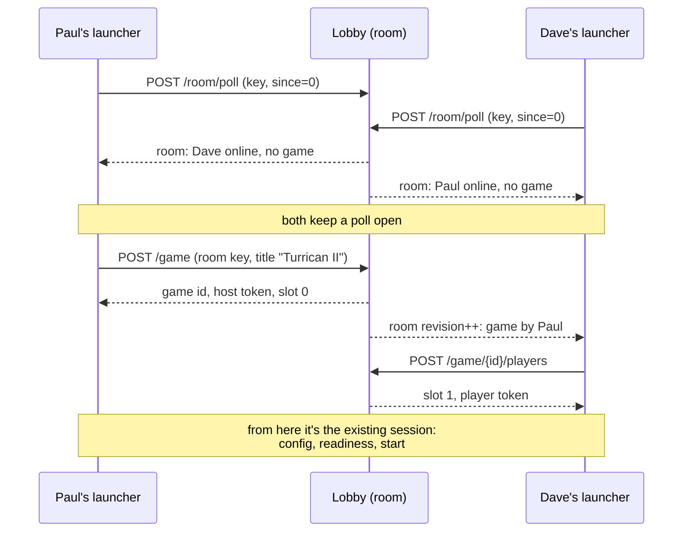

# Netplay Rooms

Design proposal for replacing IRC in netplay with a persistent **room** in the FSNP lobby: two (or more) launchers pair once, and from then on hosting a game is one click for the host and nothing at all for everyone else.

| | |
|---|---|
| **Status** | Draft for review |
| **Date** | 2026-10-25 |
| **Builds on** | [netplay-go-server-design.md](netplay-go-server-design.md) — the lobby, the session API and config in the session (phase three) |
| **Scope** | `fsnp-server` lobby (rooms), launcher netplay panel and settings; IRC removed at the end |
| **Not in scope** | Chat. We use Discord for that already |

## Contents

1. [Summary](#summary)
2. [Why](#why)
3. [What IRC does today](#what-irc-does-today)
4. [The proposal](#the-proposal)
5. [UX](#ux)
6. [Lobby API](#lobby-api)
7. [Launcher changes](#launcher-changes)
8. [Security](#security)
9. [Rollout](#rollout)
10. [Alternatives considered](#alternatives-considered)
11. [Open questions](#open-questions)

## Summary

Chat happens on Discord. IRC is only there so one launcher can tell the others "there's a game, here's where". The lobby can do that itself.

A **room** is a named rendezvous in the lobby, identified by a shared secret (the *room key*). Each launcher in the room keeps one long-poll open on it. When anyone in the room hosts a game, the lobby records it as the room's current game and wakes every watcher; their launchers join it automatically, exactly as they do today when an IRC op announces a game.

Setup is one paste, once: the person who runs the lobby copies an *invite* (lobby address + room key) to Discord, and their friend pastes it into the launcher's settings. After that there is nothing to copy per game, no IRC server, and one port to forward.

## Why

- **Two systems for one job.** We chat on Discord and keep an IRC client open only to trigger netplay. Each session needs both, plus joining the right IRC channel.
- **IRC is most of the moving parts.** An InspIRCd container and a second forwarded port (6667), the vendored `oyoyo` library (a 2012 release hand-ported to Python 3), the channel and op logic, and slash commands in the UI.
- **Pasting a game code per game doesn't fix it.** It replaces one chore with another.
- **The lobby already does the hard part.** Since phase three it holds the session: slots, config, readiness, start. IRC carries one line of it.

## What IRC does today

| IRC does | Where | After this proposal |
|---|---|---|
| Says where the game is: `__session <lobby> <game_id>`, sent by an op when someone joins the game channel | `announce_session`, `on_session_announce` in [netplay.py](../launcher/netplay/netplay.py) | The room's current game |
| Decides who may host or change config (channel op) | `channel.is_op()` checks | Hosting: anyone in the room. Config: the lobby's host token, as now |
| Player names (IRC nick, used as the lobby tag) | `irc.my_nick[:MAX_TAG_LENGTH]` | A *Netplay name* setting |
| Commands: `/hostgame`, `/startgame`, `/joingame`, `/set`, `/recheck`, `/reset` | `command_*` in `netplay.py` | Buttons; `/set` becomes the normal config UI |
| Status and error messages, shown as channel text | `game_message`, `channel.warning` | An activity log in the netplay panel |
| Chat | — | Discord |

## The proposal

### Rooms

- A room is identified by its **room key**, a random secret generated by the launcher (see [Security](#security)). Knowing the key *is* membership: there's no account and no invite flow beyond sharing it.
- Rooms are created on first use and live in memory. A room with no watchers and no game for 10 minutes is dropped. A lobby restart loses nothing that matters: watchers reconnect, the room reappears, and they wait for the next game.
- A room has at most one **current game**. Hosting in the room replaces it; the game ending clears it.
- A room tracks **members** for presence: a member is *online* while it has a poll open or answered in the last ~35 s (the lobby's 25 s long-poll wait plus margin).

### One lobby, either player hosts

Today there are two hosting paths: `/startgame` creates the game in a lobby already running elsewhere (the Docker image), and `/hostgame` starts a lobby on this machine first. A room needs a lobby that's there *before* anyone hosts, so this proposal makes "where the lobby runs" a setting, not a per-game choice:

- **Always-on lobby** (Docker on a NAS or VPS). Both launchers point at it.
- **Lobby on one player's machine.** That launcher's settings say *Run the lobby on this computer*: it starts `fsnp-server` in lobby mode when netplay is opened and stops it when it's closed. The other launcher points at that machine's public address.

Either way, **Host game** always creates the game in the room's lobby, so either player can host, and only the machine running the lobby forwards a port (TCP 25101, for the lobby and the game both). This is what `/hostgame` already does when its lobby is running ("Host this game in the same lobby, as `/startgame` would in a remote one").

### The flow



## UX

Wireframes are for layout and wording, not pixels. They show the panel in the main window. The column layout used in the netplay window gets the same parts stacked vertically.

### Settings → Net Play

The only setup. *Copy invite* puts the lobby address and room key on the clipboard as one line to paste into Discord. *Paste invite* fills both fields from such a line.

```
┌─ Net Play ────────────────────────────────────────────────────────────┐
│                                                                       │
│  Netplay name     [ Paul                         ]                    │
│                                                                       │
│  Lobby                                                                │
│    (•) Use a lobby server   [ netplay.example.net:25101    ]          │
│    ( ) Run the lobby on this computer                                 │
│          Players reach it at [ 203.0.113.4               ]            │
│          Forward TCP 25101 to this computer.                          │
│                                                                       │
│  Room key         [ k7qm-x2rd-9htv-ae4p          ]  [ Generate ]      │
│                                                                       │
│  [ Copy invite ]  [ Paste invite ]                                    │
│                                                                       │
│  [x] Join games in this room automatically                            │
│                                                                       │
└───────────────────────────────────────────────────────────────────────┘
```

The invite line, as it would appear in Discord:

```
fs-uae netplay room: netplay.example.net:25101 k7qm-x2rd-9htv-ae4p
```

### Netplay panel: in the room, no game

The channel list, nick list, chat area and command field are gone. The room shows who's online; **Host game** is always available.

```
┌─ Net Play ──────────────────────────────────────────────── (i) ───────┐
│                                                                       │
│  Room  netplay.example.net                        ● connected         │
│    ● Paul (you)                                                       │
│    ● Dave                                                             │
│                                                                       │
│  No game.                                                             │
│                                                                       │
│  Players [ 2 ▾]        [ Host game: Turrican II ]                     │
│                                                                       │
│  ── Activity ─────────────────────────────────────────────────────    │
│  20:14  Connected to the room                                         │
│  20:15  Dave is online                                                │
│                                                                       │
└───────────────────────────────────────────────────────────────────────┘
```

The button names the config that's loaded, so it's clear what will be shared. With no config loaded it's disabled, with the tooltip "Choose a game first".

### Hosting

```
┌─ Net Play ──────────────────────────────────────────────── (i) ───────┐
│                                                                       │
│  Room  netplay.example.net                        ● connected         │
│    ● Paul (you)   ● Dave                                              │
│                                                                       │
│  Turrican II — hosted by you, configuring                             │
│    1. Paul (you) — ready                                              │
│    2. Dave — missing: Turrican II (Disk 2).adf                        │
│                                                                       │
│  [ Start game ]  [ Re-check ]  [ End game ]                           │
│   └ disabled: "Waiting: Dave is missing files"                        │
│                                                                       │
│  ── Activity ─────────────────────────────────────────────────────    │
│  20:16  Hosting Turrican II for 2 players                             │
│  20:16  Dave joined as player 2                                       │
│                                                                       │
└───────────────────────────────────────────────────────────────────────┘
```

The slot lines and the *Waiting:* tooltip are today's `slot_lines()` and `waiting_on()`. Config changes the host makes in the normal UI reach everyone as they do now.

### Joined (the other player, who did nothing to get here)

```
┌─ Net Play ──────────────────────────────────────────────── (i) ───────┐
│                                                                       │
│  Room  netplay.example.net                        ● connected         │
│    ● Paul   ● Dave (you)                                              │
│                                                                       │
│  Turrican II — hosted by Paul, configuring                            │
│    1. Paul — ready                                                    │
│    2. Dave (you) — missing: Turrican II (Disk 2).adf                  │
│                                                                       │
│  [ Re-check ]  [ Leave ]                                              │
│                                                                       │
│  ── Activity ─────────────────────────────────────────────────────    │
│  20:16  Paul is hosting Turrican II; joined as player 2               │
│  20:16  Missing Turrican II (Disk 2).adf — add it, then Re-check      │
│                                                                       │
└───────────────────────────────────────────────────────────────────────┘
```

With *Join automatically* turned off, the game appears with a **Join** button instead, and nothing happens until it's clicked.

### Running

```
│  Turrican II — hosted by Paul, running                                │
│    1. Paul   2. Dave (you)                                            │
│                                                                       │
│  [ Leave ]                                                            │
```

When the game ends, the panel goes back to *No game* and the room's next game is joined as before. If a game is already running when a launcher comes online, it shows as running and isn't joined: there's no slot to take mid-game until rejoin (phase four) exists.

### Can't reach the lobby

```
│  Room  netplay.example.net                        ○ can't reach it    │
│    Retrying in 10 s. If the lobby runs on Paul's computer, netplay    │
│    needs to be open there.                                            │
│                                                                       │
│  [ Host game ] (disabled)                                             │
```

The watcher retries with backoff (1 s, doubling, capped at 10 s), the same as the session watcher in `lobby_client.py`. With *Run the lobby on this computer*, failing to start it shows the existing errors from `start_hosted_server` (port in use, missing binary) in the activity log.

## Lobby API

New routes alongside the session API in [api.go](../fsnp-server/internal/lobby/api.go). The room key travels in the request body, never the URL, so it doesn't end up in access logs or proxies.

```
POST /room/poll        watch a room; long-polls past revision
POST /game             existing; gains optional "room" and "title"
```

`POST /room/poll`:

```json
{ "room": "k7qm-x2rd-9htv-ae4p", "member": "c3f1…", "name": "Dave", "since": 6 }
```

`member` is a random ID the launcher makes once per run, so two launchers with the same name stay separate. The response is the room snapshot, as soon as its revision is past `since`, or after the usual 25 s wait:

```json
{
  "revision": 7,
  "members": [
    { "name": "Paul", "online": true },
    { "name": "Dave", "online": true }
  ],
  "game": {
    "id": "6f1c…",
    "title": "Turrican II",
    "host": "Paul",
    "state": "configuring",
    "players": 2,
    "open": 1
  }
}
```

`game` is `null` when there's none. The revision moves when a member comes or goes, a game is created, changes state (so watchers see *running* and *ended*), or a slot is claimed or freed. Joining still goes through `POST /game/{id}/players`, so the room snapshot carries no tokens and no password.

`POST /game` with `"room"` makes the new game the room's current one. `"title"` is display-only, taken from the host's loaded config name, since `__config_name` isn't a synced key. Without `"room"`, `POST /game` behaves exactly as now, so the Docker lobby keeps working with older launchers.

Implementation notes:

- The room's long-poll is the same shape as `waitSnapshot`: a revision counter and a channel replaced on each change to wake waiters.
- A game's state changes already pass through the lobby's entry, which has `l.mu` held. Bumping the room revision there is a field on the entry pointing at its room.
- Limits: `--max-rooms` (default 64; `503` past it), a room drops its game reference when the game is reaped, and rooms are reaped after 10 minutes with no members and no game.

## Launcher changes

| Piece | Change |
|---|---|
| `RoomWatcher` (new, in `launcher/netplay/room.py`) | A daemon thread that long-polls `/room/poll` and posts each snapshot to the UI thread with `call_after`, like the session watcher in [lobby_client.py](../launcher/netplay/lobby_client.py), and with the same backoff |
| `Netplay` | `on_session_announce(nick, arg)` becomes `join_room_game(host, lobby, game_id)`, called from the room watcher. Its join, stale-generation and leave-quietly handling stays as it is. `create_session` passes the room key and title. Messages go to the activity log instead of `self.irc` |
| Lobby on this computer | The existing `Server(port, …, lobby=True)` path from `command_hostgame`, started when the panel opens and stopped when it closes, unless a game in it is still running (as `release_hosted_server` does now) |
| `NetplayPanel` | Room header, slot list, buttons and activity log as in the wireframes. Port and player fields go: the port moves to settings, players becomes a drop-down next to Host |
| Settings | New: `netplay_name`, `netplay_lobby`, `netplay_run_lobby`, `netplay_public_address`, `netplay_room`, `netplay_auto_join`. `irc_nick` is migrated to `netplay_name` on first run. Removed: `irc_server`, `irc_nick` |
| Removed at the end | `irc.py`, `channel.py`, `command_handler.py`, `irc_broadcaster.py`, `irc_color.py`, `oyoyo/`, the oyoyo credits in `README` and the About dialog, the `irc` service and `irc/netplay.conf` from [compose.yaml](../fsnp-server/compose.yaml) |

The emulator side doesn't change: FSNP v1 and the game server are untouched.

## Security

- **The room key is the only gate to the room.** Anyone with it sees who's online and auto-joins hosted games. Generated keys are 16 characters from the lobby's existing 32-symbol password alphabet (lowercase, no `l`, `o`, `0`, `1`), 80 bits, grouped in fours for reading aloud. *Generate* makes a new one; changing it is how you remove someone.
- **The game password still applies.** It's generated by the lobby and reaches players through the synced config, as now; the room doesn't weaken it.
- **Plain HTTP, as today.** The lobby has no TLS, so the room key crosses the network in clear text, the same as player tokens and the game password hash already do. That's the existing threat model, not a new one.
- **Stored hashed.** The lobby keeps `sha256(room key)`, so a dump of its memory or logs doesn't reveal working keys.

## Rollout

Each step is its own commit (or PR), green on its own, and leaves netplay usable.

1. **Rooms in the lobby.** `POST /room/poll`, `room`/`title` on `POST /game`, reaping, limits. Go tests for long-poll wakeups, presence expiry and the game lifecycle reaching the room.
2. **Room watcher alongside IRC.** Settings for lobby and room key, `RoomWatcher`, auto-join through the shared join path. IRC still works, so we can play both ways and compare.
3. **Host from the room.** *Host game* creates in the room's lobby. *Run the lobby on this computer* replaces `/hostgame`'s per-game lobby start.
4. **New panel.** Room header, buttons, activity log. IRC messages move to the log.
5. **Remove IRC.** Delete the IRC modules, `oyoyo`, the InspIRCd service and the IRC settings.
6. *(Optional)* **Discord webhook.** A `DISCORD_WEBHOOK_URL` for the lobby to post "Paul is hosting Turrican II" to a channel. A heads-up only; nobody needs to act on it.

## Alternatives considered

- **Paste a join code into Discord per game.** No server changes, but it's a chore every game. Rejected for that.
- **A Discord bot relaying into the launcher.** A bot token can't ship in a desktop app, and automating user accounts is against Discord's terms, so it needs a relay server we'd host. More work than IRC for no gain.
- **Discord Social SDK.** Its lobbies would fit, but it's a proprietary C++ library with no Python binding. Bundling it with a GPL-2 launcher needs a legal check, and the Debian package couldn't include it. Linux support is unclear, and development limits allow 100 lobby messages per 2 hours per app. It also ties every user to one Discord app the project owns.
- **Keep IRC, drop only the channels.** Still the server, the port, `oyoyo` and the op rules for one message.

## Open questions

1. **Where does our lobby run?** Always-on (Docker) or on one of our machines? It decides which settings mode we use day to day. Both are in the design, but we'd build and test the one we use first.
2. **Taking turns running the lobby.** If we each want to run it on our own machine on different nights, a launcher would need to watch two addresses. Not in this design. Is it needed?
3. **#112 (game-based channel names, private join announcements)** only just landed and step 5 removes it. Is anyone besides us using the IRC lobby who'd lose out?
4. **Auto-join default.** On is the point of the design, but a game appearing in your launcher unasked could surprise someone. Keep it on?
5. **More than two players.** Rooms work for any size, but one room has one current game. If four people in a room want two separate games, the second host replaces the first's game in the room. Fine for us; worth a room-per-group note in the docs?
